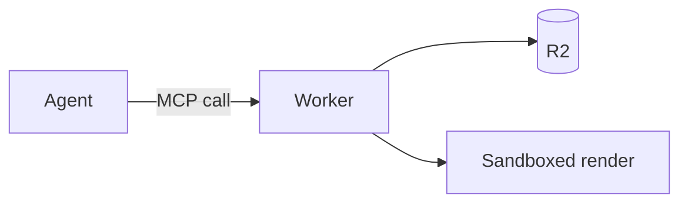

# Artifact types: recipes and limits

Each section gives the renderer behavior, the limits and a small example. All types run in the same sandbox and get the theme tokens from `SKILL.md`.

## html

- Send a full standalone document with `<!doctype html>`, `<meta name="viewport">` and a `<title>`. The renderer adds only the theme tokens and script after your document.
- There is no Tailwind and no import map. Write plain CSS with the tokens.
- You can load libraries from a CDN, for example `<script type="module">import * as d3 from 'https://esm.sh/d3@7';</script>`.
- A Mermaid diagram that the page draws itself (`<pre class="mermaid">` or `mermaid.render`) gets pan and zoom from the renderer: drag, pinch or Ctrl/Cmd + wheel, double-click to reset, and a toolbar on hover. This also applies in `react`. For a page that is only one diagram, use the `mermaid` type.
- The renderer adds no error panel to `html`. A script error is silent, so keep scripts small and simple.
- Open external links in a new tab: `<a href="..." target="_blank" rel="noopener">`. The sandbox blocks navigation of the top window.
- Print gives the PDF export. Add `@media print` rules when the page contains fixed or interactive parts.

## react

- Send one `.tsx` or `.jsx` file with a default export.
- Babel compiles TypeScript and JSX in the browser. React and React DOM are version 19.3.0.
- Import npm packages by bare name: `import { LineChart } from 'recharts'`. The renderer loads them from esm.sh with React as an external.
- You can pin a version in the name: `'recharts@2'`. Do not import a full `https://esm.sh/...` URL for a React library, because it can load a second copy of React.
- There are no relative imports, because the artifact is one file. Do not import CSS files. Use Tailwind classes or a `<style>` element.
- Tailwind v4 runs in the browser. Its preflight removes default heading sizes, margins and list bullets, so style them with classes.
- Load and render errors show in a red panel at the bottom of the page.
- shadcn/ui is not available. For icons, import `lucide-react`.
- For a dashboard, put the data in the file. To refresh the data, update the artifact.

```tsx
import { useState } from 'react';
import { ChevronDown } from 'lucide-react';

export default function Menu() {
  const [open, setOpen] = useState(false);
  return (
    <div className="min-h-dvh bg-bg p-6 text-fg font-sans text-[15px]">
      <button aria-expanded={open} onClick={() => setOpen(!open)}
        className="inline-flex h-8 items-center gap-1 rounded-[var(--radius)] border border-border bg-surface px-3 hover:bg-surface-2 focus-visible:outline-2 focus-visible:outline-accent">
        Actions <ChevronDown size={16} aria-hidden="true" />
      </button>
      {open && <ul className="mt-1 w-48 rounded-[var(--radius)] border border-border bg-surface p-1 shadow-[var(--shadow)]">...</ul>}
    </div>
  );
}
```

## slides

- Write a Markdown deck. A line with only `---` and a blank line before it starts a new slide.
- The blank line is necessary. Without it, `Text` followed by `---` becomes a level-2 heading.
- `***` and `___` on their own line also start a new slide. `---` inside a fenced code block does not.
- Do not start the deck with YAML front matter. The renderer removes empty slides.
- Each slide is a `<section class="slide">` of 1280x720px, scaled to fit. It has 64px by 80px padding and 28px text. `h1` is 64px, `h2` is 44px, `h3` is 34px.
- The slide clips content that does not fit. Use one idea per slide, a title and at most about 6 short bullets.
- There is no Tailwind. A `<style>` block can change the layout. The defaults use `:where()` with zero specificity, so a selector such as `.slide h1` wins.
- Put the `<style>` block on the first content slide. A slide that contains only a `<style>` block shows as an empty slide.
- In a raw HTML block, put blank lines around the Markdown inside it. Without them, the Markdown is not parsed.
- Users move with the arrow keys, Space, Page Up, Page Down, Home and End. `F` toggles full screen. Print gives one slide on each page.

```markdown
<style>.cols{display:grid;grid-template-columns:1fr 1fr;gap:48px}.slide h1{color:var(--accent)}</style>

# Q3 review

Platform team, October 2026

---

## Two numbers

<div class="cols">

**+18%** signups

**-40ms** p95 latency

</div>
```

## design

- Send an HTML fragment, not a full document. The renderer puts it into a canvas that users pan and zoom.
- Give each screen its own `data-artboard="Name"` element with a fixed size. An artboard inside another artboard is not a separate screen.
- Common sizes are 390x844 (phone), 834x1194 (tablet) and 1440x900 (desktop).
- Artboards show side by side with an 80px gap. Each one gets a caption with its name. For a flow, use names such as `1 Sign in` and `2 Verify code`.
- Tailwind and the token colors are available. An artboard is white by default. Set `bg-bg text-fg font-sans` on each artboard to use the theme.
- Scripts run, so clickable prototypes work. All artboards share one document, so use unique `id` values.
- The mouse wheel pans the canvas and Ctrl or Cmd with the wheel zooms. Scrolling inside an artboard does not work, so make a long page a tall artboard.
- When focus is not on a form field, button or link, the keys `+`, `-`, `0` and Space control the canvas. Do not use them in a prototype.
- Print gives one artboard on each page.

```html
<div data-artboard="1 Sign in" class="flex flex-col gap-4 bg-bg p-6 text-fg font-sans" style="width:390px;height:844px">
  <h1 class="mt-24 text-2xl font-semibold">Sign in</h1>
  <label class="text-[13px] text-muted">Email <input type="email" class="mt-1 block h-11 w-full rounded-[var(--radius)] border border-border bg-surface px-3 text-[15px] text-fg"></label>
  <button class="h-11 rounded-[var(--radius)] bg-accent font-medium text-on-accent">Continue</button>
</div>
```

## motion

- Send a full standalone HTML document. The renderer adds a player bar with play, pause, restart, a timeline scrubber and loop.
- Animate only with CSS animations, CSS transitions or `Element.animate()`. The player controls `document.getAnimations()`.
- Do not time anything with `requestAnimationFrame`, `setTimeout`, GSAP or other libraries. The player cannot control them.
- Start all animations when the page loads. Give each one a finite duration and `fill-mode` `both` or `forwards`.
- The end of the latest animation, delay included, sets the timeline length. Infinite animations do not add to the length.
- Use `animation-delay` to put scenes in sequence. A good length is 5-15 seconds.
- With reduced motion, the player starts paused on the final frame. Print also shows the final frame. Make the final frame a complete still image.
- The player bar is 44px high at the bottom and hides during playback. Keep important content out of the bottom 44px.
- Set `--bg` and `--fg` yourself. Animate `transform` and `opacity`. Use ease-out for entries.

```html
<!doctype html>
<html lang="en">
<head>
<meta charset="utf-8">
<meta name="viewport" content="width=device-width, initial-scale=1">
<title>Request flow</title>
<style>
  body { margin: 0; min-height: 100dvh; display: grid; place-items: center; background: var(--bg); color: var(--fg); font: 15px var(--font); }
  .step { padding: 12px 16px; border: 1px solid var(--border); border-radius: var(--radius); background: var(--surface);
          animation: enter 600ms ease-out both; }
  .step:nth-child(2) { animation-delay: 800ms; }
  .step:nth-child(3) { animation-delay: 1600ms; border-color: var(--accent); }
  @keyframes enter { from { opacity: 0; transform: translateY(12px); } }
</style>
</head>
<body>
  <div style="display:flex;gap:24px"><div class="step">Agent</div><div class="step">MCP</div><div class="step">Worker</div></div>
</body>
</html>
```

## mermaid

- Send only the diagram source, without a code fence. Mermaid is version 12.1.0.
- The diagram shows on the same pan and zoom canvas as `design`. Fit sets the zoom to show all of it.
- The renderer sets the Mermaid theme. Do not put a theme directive or fixed `classDef` colors in the source.
- A syntax error shows in a red panel at the bottom of the page.
- Use `flowchart LR` for wide processes and `flowchart TD` for tall ones. Keep labels short.
- Put quotes around a label with special characters: `A["Sign in (SSO)"]`. Use `subgraph` to group parts.
- Keep one diagram to about 30 nodes. Make two diagrams when it is larger.



## markdown

- marked parses the document with GitHub Flavored Markdown: tables, task lists and strikethrough. The page has the GitHub layout with the theme colors, 980px wide at most.
- Fenced code blocks show without syntax highlighting. A `mermaid` code block shows as text, not as a diagram.
- marked keeps raw HTML, but `<script>` elements do not run.
- Start with one `#` title. Use `##` and `###` in sequence.

## code

- Set `language` to a highlight.js name, for example `python`, `typescript`, `bash`, `sql`, `yaml` or `rust`.
- If `language` is missing or unknown, highlight.js guesses the language.
- `language` has 32 characters at most, from letters, digits and `+#._-`.
- The file shows in 13px monospace, without line numbers. Use `markdown` when the code needs explanation around it.

## svg

- Send one `<svg>` element with `xmlns="http://www.w3.org/2000/svg"`, `width`, `height` and a `viewBox`. The renderer centers it and shrinks it to fit the window.
- The raw download has no tokens. Give each token a fallback: `fill="var(--fg, #3c3836)"`.
- Do not depend on a page background. Add a `<rect>` with `fill="var(--bg, #fbf1c7)"` when the image needs one.
- Give a meaningful image a `<title>` as the first child.
